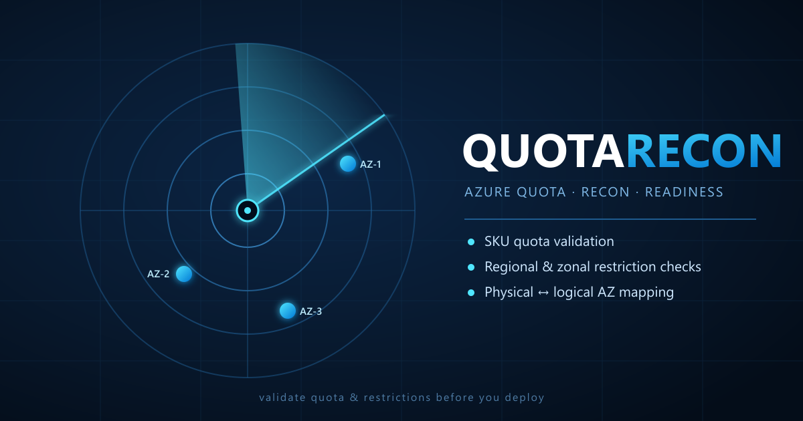
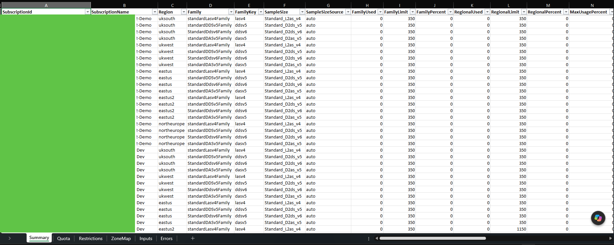
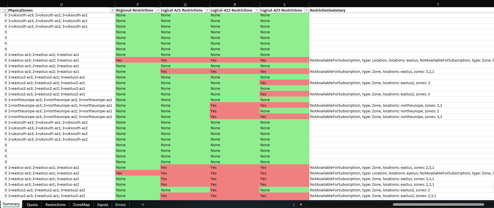
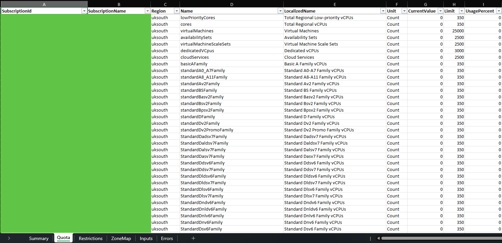
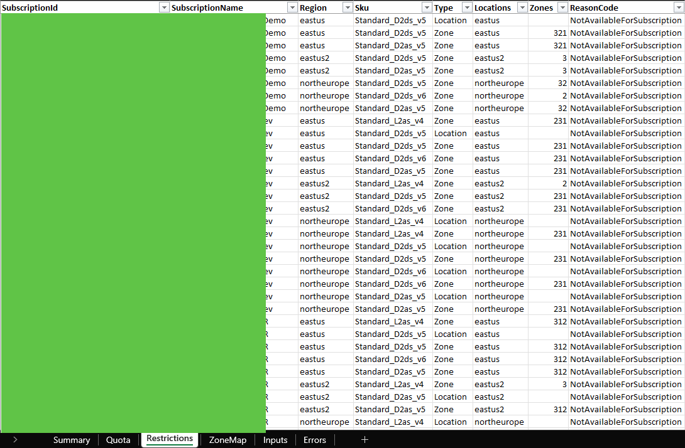
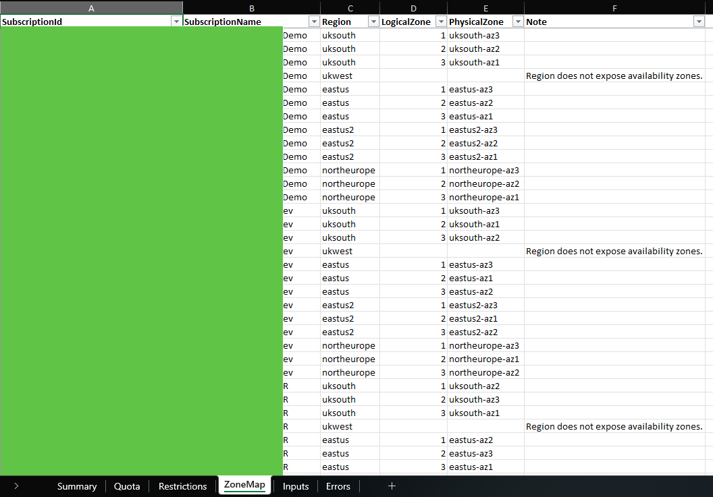

# QuotaRecon



**Reconnaissance for Azure compute quota, SKU restrictions, and availability-zone
mappings across many subscriptions, regions, and SKUs — in one Excel workbook.**

> **Current release:** see [CHANGELOG.md](CHANGELOG.md). Every run prints the
> version at the top; `./Invoke-QuotaRecon.ps1 -Version` prints and exits.

> ⚠️ **Not a Microsoft product.** QuotaRecon is a personal open-source
> project maintained in an individual capacity. It is not affiliated with,
> endorsed by, or supported by Microsoft. It is provided **"AS IS"** under
> the MIT [LICENSE](LICENSE) with no warranty of any kind. Do not open
> Microsoft support cases for issues with this tool — open a GitHub issue
> instead.

QuotaRecon answers the questions that come up on every capacity call:

1. **Do I actually have quota for `<SKU>` in `<region>` on `<subscription>`?**
   Regional vCPU limit, family vCPU limit, and current usage — all rolled up per
   Sub × Region × SKU.
2. **Is this SKU even offered here, and are any zones restricted?**
   Reads `Microsoft.Compute/skus` and surfaces every `Location`, `Zone`, and
   `NotAvailableForSubscription` restriction with its `ReasonCode`.
3. **Which logical zone (`1`/`2`/`3`) is which physical zone for this
   subscription?**
   Calls `Microsoft.Resources/checkZonePeers` and produces a logical → physical
   zone map per Sub × Region, so you can reason about co-location across
   subscriptions.

Output is a single `.xlsx` with one worksheet per concern plus a rolled-up
`Summary` sheet suitable for review or handoff.

---

## Output Examples

### Per subscription / per region summary of SKU quota, physical zone mapping for AZs, and any region / zonal restrictions

The `Summary` sheet gives you every combination of (Subscription × Region ×
Family) on one row: family + regional vCPU quota on the left, physical
zone mapping and per-zone restriction status on the right. Green cells are
`None` (no restriction), red cells are `Yes` (restriction present); the
`RestrictionSummary` column carries the full `az vm list-skus`-style detail
line.





### Full quota snapshot for each subscription / region for all SKUs

The `Quota` sheet is the raw `Microsoft.Compute/locations/{region}/usages`
output — every counter Azure reports (regional total vCPUs, low-priority
vCPUs, VMs, availability sets, VMSS, dedicated vCPUs, and every family
counter) for every (Subscription × Region) pair. Useful for looking
beyond the families listed in `templates/skus.csv`, or for handing off the
un-filtered snapshot.



### Separate tab listing any subscription SKU restrictions in place

The `Restrictions` sheet is the flattened
`Microsoft.Compute/skus[].restrictions[]` list — one row per restriction
per (Subscription × Region × Sku). Each row shows `Type` (`Location` or
`Zone`), the `Locations` and `Zones` the restriction applies to, and the
`ReasonCode` (typically `NotAvailableForSubscription`). This is the raw
data behind the `Regional-Restrictions` and `Logical-AZn-Restrictions`
cells in the `Summary` sheet.



### Zone mapping for each subscription / region — logical AZ to physical AZ

The `ZoneMap` sheet is built from
`GET /subscriptions/{id}/locations?api-version=2022-12-01` and its
`availabilityZoneMappings` array. For every (Subscription × Region) it
lists each `LogicalZone` (`1`/`2`/`3`) and the `PhysicalZone` label the
platform maps it to (e.g. `uksouth-az1`). Two subscriptions in the same
tenant whose logical `1` resolves to the same physical label are
co-located. Non-AZ regions carry a `Note` explaining why no mapping is
available.



---

## Requirements

- **PowerShell 7+** (Windows PowerShell 5.1 also works, but 7 is recommended).
- **`Az.Accounts` PowerShell module** — used for `Get-AzAccessToken` and the
  `Get-AzSubscription` fallback in the subscription-name resolver. Sign in
  once with `Connect-AzAccount` before running.
- **`ImportExcel` PowerShell module** — used to write the `.xlsx` workbook
  with conditional formatting.
- Read access on every subscription in your list (`Reader` role is enough).

Install both modules in one line:

```powershell
Install-Module Az.Accounts, ImportExcel -Scope CurrentUser -Force
```

QuotaRecon deliberately avoids `az rest` / `az.cmd` because those re-parse
arguments through `cmd.exe` and break on `?` in URLs. It uses
`Get-AzAccessToken` + `Invoke-RestMethod` directly.

---

## Get the script

Two ways to get a local copy — pick whichever you're comfortable with.

### Option A — Download the ZIP (no git required)

1. Go to https://github.com/MS-mikeo/QuotaRecon.
2. Click the green **Code** button → **Download ZIP**.
3. Right-click the downloaded ZIP → **Properties** → tick **Unblock** →
   **OK**. (Windows marks files downloaded from the internet as blocked;
   this one click unblocks every file inside.)
4. Extract the ZIP anywhere, e.g. `C:\Tools\QuotaRecon`.
5. Open PowerShell in that folder and run the Quick start steps below.

If you skip step 3, you can unblock the extracted files instead:

```powershell
Get-ChildItem -Path C:\Tools\QuotaRecon -Recurse | Unblock-File
```

If PowerShell refuses to run the scripts with an execution-policy error,
allow signed and local scripts for your user only:

```powershell
Set-ExecutionPolicy -Scope CurrentUser -ExecutionPolicy RemoteSigned
```

### Option B — Clone with git

```powershell
git clone https://github.com/MS-mikeo/QuotaRecon.git
cd QuotaRecon
```

New releases are just `git pull` away.

---

## Quick start

```powershell
# 1. Sign in and pick any subscription in the target tenant.
Connect-AzAccount
Set-AzContext -Subscription <any-sub-in-the-tenant>

# 2. Copy the sub template to a LOCAL copy that git will ignore, and put
#    your real GUIDs there. `*.local.csv` is in .gitignore.
Copy-Item ./templates/subscriptions.csv ./templates/subscriptions.local.csv

# 3. Edit templates/subscriptions.local.csv, templates/regions.csv, and
#    templates/skus.csv to taste. Then run:
./Invoke-QuotaRecon.ps1 `
    -SubscriptionsCsv ./templates/subscriptions.local.csv `
    -RegionsCsv       ./templates/regions.csv `
    -SkusCsv          ./templates/skus.csv
```

You can also pass values inline instead of using the CSVs:

```powershell
./Invoke-QuotaRecon.ps1 `
    -SubscriptionIds '11111111-1111-1111-1111-111111111111','2222...' `
    -Regions         'eastus2','westus3' `
    -Skus            'Ddsv6','Ddsv5','Standard_E8ds_v5'
```

Or omit everything and let the script prompt you interactively.

### Diagnostic mode

Add `-DiagnosticLog` to any invocation to write a full transcript log
(including every ARM URL and any 4xx response body) to
`<OutputPath>.log`. Useful for reproducing a weird result. Do not share the
log file without redacting — it contains subscription GUIDs.

### Group quotas (opt-in)

[Microsoft.Quota group quotas](https://learn.microsoft.com/azure/quotas/quota-groups)
(pooled vCPU allocations across subscriptions in a Management Group) are
**opt-in** as of **v1.1.0**. Pass `-IncludeQuotaGroups` to enumerate every
MG the caller can see and probe each, or `-QuotaGroupMgIds` to narrow the
probe to specific MGs (which also implies opt-in).

```powershell
./Invoke-QuotaRecon.ps1 `
    -SubscriptionsCsv ./templates/subscriptions.local.csv `
    -RegionsCsv       ./templates/regions.csv `
    -SkusCsv          ./templates/skus.csv `
    -IncludeQuotaGroups
```

When the switch isn't passed, the `QuotaGroupLimits` and
`QuotaGroupAllocations` sheets are empty and the `InQuotaGroup` column on
`Summary` reads `No` on every row. `-SkipQuotaGroups` is still accepted
for backward compatibility and now acts as a no-op (default is already
skip).

### Invalid input callouts

QuotaRecon prints every unresolved subscription GUID, region, and SKU
(including family entries that didn't match anything in the live catalog)
to the console as a `WARNING` before the collection phase begins. The same
rows also appear on the `Inputs` sheet. On the `Summary` sheet, rows where
the family's sample size isn't offered in a particular region now show
`N/A` (uncoloured) for the restriction columns instead of `None` (green),
so you can tell at a glance that there's no data for that family in that
(sub, region).

### All SKUs in region (opt-in)

Add `-IncludeAllSKUs` to any invocation to **ignore** the Skus / SkusCsv
input and instead enumerate every VM family present in the union of the
target regions' `Microsoft.Compute/skus` catalogs. One Summary row per
`(Sub × Region × Family)` for everything Azure offers you in those
regions. Useful for a wide-angle scan when you don't have a pre-built SKU
list, or just want to see what's broadly available.

```powershell
./Invoke-QuotaRecon.ps1 `
    -SubscriptionsCsv ./templates/subscriptions.local.csv `
    -RegionsCsv       ./templates/regions.csv `
    -IncludeAllSKUs
```

You can combine it with a Skus list — in that case, user-supplied families
keep whichever `SampleSize` you asked for, and the catalog adds every
other family on top. Catalog-sourced rows show `SampleSizeSource = catalog`
on the `Inputs` sheet so you can tell which rows came from the switch.

> Scale note: this can produce a lot of rows (dozens of families × every
> sub × every region). The script still caches catalogs per `(sub, region)`
> so it's one extra `/skus` enumeration up front, not one per family.

### VM inventory (opt-in)

Add `-IncludeVmInventory` to any invocation to list every deployed VM and
VM Scale Set whose size belongs to one of the requested SKU families and
whose location is in the target region list. Adds a `VMInventory` sheet and
a `DeployedVmCount` column to the `Summary` sheet.

```powershell
./Invoke-QuotaRecon.ps1 `
    -SubscriptionsCsv ./templates/subscriptions.csv `
    -RegionsCsv       ./templates/regions.csv `
    -SkusCsv          ./templates/skus.csv `
    -IncludeVmInventory
```

Under the hood: one **Azure Resource Graph** POST covers all subscriptions
in a single call (paginated with `$skipToken` past 1000 rows). The KQL
query unions `microsoft.compute/virtualmachines` and
`microsoft.compute/virtualmachinescalesets`, filters to the target sizes /
regions, and projects a common column set. The extra network cost is
usually well under a second, but the switch is opt-in so nothing extra runs
unless you ask.

**Columns in the `VMInventory` sheet:**

| Column | Meaning |
| --- | --- |
| `SubscriptionId`, `SubscriptionName` | consistent identity block |
| `ResourceGroup`, `VmName`, `ResourceId` | ARM identity of the resource |
| `Region` | e.g. `eastus2` |
| `VmSize` | e.g. `Standard_D4ds_v5` |
| `Family`, `FamilyKey` | joined from the compute SKU catalog |
| `Zone` | `1`, `2`, `3`, or `Regional` (no zone binding) |
| `PowerState` | `running`, `deallocated`, etc.; `(scale-set)` for a VMSS row; `(unknown)` if Resource Graph has no `instanceView` for the sub yet |
| `Deployment` | `VM` for single VMs, `VMSS` for scale sets |
| `InstanceCount` | `1` for a plain VM, `sku.capacity` for a VMSS |

**How the `Summary` sheet uses it:**

- `DeployedVmCount` is a per-(Sub × Region × Family) sum of `InstanceCount`
  across every inventory row that matched. Useful to compare "quota
  allocated" vs "actually running": a family with 100 vCPU of quota and
  `DeployedVmCount = 0` is idle capacity; a family with 800 vCPU of quota
  and 500 running is nearly saturated.
- When the switch isn't passed, `DeployedVmCount` is `0` for every row.

**Caveats:**

- `PowerState` comes from `properties.extended.instanceView.powerState.code`
  in Resource Graph. On some subs (typically fresh ones) that field is empty
  and the column reads `(unknown)`. That's not a QuotaRecon bug — Resource
  Graph just hasn't collected instanceView for that sub yet.
- A VMSS is emitted as **one row** representing the whole scale set with
  `InstanceCount = sku.capacity`. Per-instance rows would require an extra
  ARM enumeration per VMSS and are on the roadmap for a later release.

### Reference data (regions + all VM SKUs)

Under `references/` you'll find two CSVs generated from the live Azure
catalog: `regions-reference.csv` (109 regions with physical-zone mappings)
and `vm-skus-reference.csv` (every VM size with its family and the regions
that offer it). These are **reference only** — the tool never consumes them
as input. Regenerate them with `tools/New-QRReferences.ps1`.

---

## Input formats

All three CSVs are single-column, header-first, comma- or newline-separated.
Blank lines and `#` comments are ignored. Casing and whitespace are normalized.

### `templates/subscriptions.csv`

```csv
SubscriptionId
11111111-1111-1111-1111-111111111111
22222222-2222-2222-2222-222222222222
```

Values must be GUIDs. Anything else is reported in the `Errors` sheet.
**Real GUIDs belong in `subscriptions.local.csv`** — that filename pattern
is in `.gitignore`, so real IDs never end up on GitHub.

### `templates/regions.csv`

Accepts either the ARM name (`eastus2`) or the display name (`East US 2`).
Case and spaces are ignored. Unknown values are reported with the closest
match suggestion. See `references/regions-reference.csv` for every valid
value.

```csv
Region
eastus2
West US 3
southcentralus
```

### `templates/skus.csv`

Accepts any of these forms (all normalize to `Standard_D4s_v5`):

- `Standard_D4s_v5`
- `D4s_v5`
- `D4s v5`
- `D4sv5`

You can also supply a **family** (`Ddsv5`, `Ddsv6`, `Dasv5`, `Lasv4`,
`Easv5`, `Msv2`, ...). QuotaRecon aggregates to family level in the
`Summary` sheet — one row per (Sub × Region × Family) — and auto-picks the
smallest offered size in that family as the "sample" it uses to look up the
region/zone restrictions. If you supply a specific size, that size becomes
the sample. See `references/vm-skus-reference.csv` for every valid family
and size.

```csv
Sku
Ddsv6
Ddsv5
Standard_M128ms
```

---

## Output workbook

| Sheet                     | One row per                              | What it tells you                                                         |
| ------------------------- | ---------------------------------------- | ------------------------------------------------------------------------- |
| `Summary`                 | Sub × Region × **Family**                | Family quota %, region-wide + per-zone restriction status, physical zones, group-pool membership, deployed-VM count |
| `Quota`                   | Sub × Region × quota counter             | Raw `Microsoft.Compute` usage rows (regional vCPU, family vCPU, etc.)     |
| `Restrictions`            | Sub × Region × Sample size × restriction | Restriction `Type`, `Locations`, `Zones`, `ReasonCode` (one row each)     |
| `ZoneMap`                 | Sub × Region × logical zone              | `PhysicalZone` label (e.g. `uksouth-az1`) per sub — from `/locations`     |
| `QuotaGroupLimits`        | MG × Group × Region × Family             | Pool ceiling and current available limit for the Microsoft.Quota group    |
| `QuotaGroupAllocations`   | MG × Group × Region × Family × Sub       | Per-sub allocation (`Contributed` / `Drawn`) in the group pool            |
| `VMInventory`             | Deployed VM or VMSS                      | `VmName`, `VmSize`, `Family`, `Zone`, `PowerState` — only when `-IncludeVmInventory` is passed |
| `Inputs`                  | Raw input value                          | What you supplied vs what QuotaRecon normalized it to                     |
| `Errors`                  | Failure or skip                          | Auth, 4xx, unregistered providers, unknown regions/SKUs — never fails the whole run |

The `Summary` sheet uses conditional formatting:

- **`MaxUsagePercent`** — yellow ≥ 80 %, red ≥ 95 %.
- **`Regional-Restrictions`**, **`Logical-AZ1-Restrictions`**,
  **`Logical-AZ2-Restrictions`**, **`Logical-AZ3-Restrictions`** —
  three-value cells:
  - `None` → **green** (offered and unrestricted)
  - `Yes` → **red** (offered but restricted)
  - `N/A` → **uncoloured** (not offered in this zone / region at all,
    or the family has zero sizes in this region's catalog)
- **`InQuotaGroup`** — light blue when `Yes`.
- **`Note`** — free-text explanation when a row's data is missing or a
  fallback was used (e.g. `Family 'standardDCSv3Family' has no sizes offered
  in australiasoutheast`, `Sample size 'Standard_DC2s_v3' not offered in X;
  probed 'Standard_DC1s_v3' instead`, `Microsoft.Compute provider
  NotRegistered on this subscription`).
- **`OfferedSizesInRegion`** — how many sizes in the family exist in that
  region's resourceSkus catalog. `0` means the family isn't offered there.
- **`ProbeSampleUsed`** — the SKU name actually used to probe restrictions.
  If it differs from `SampleSize`, the Note explains why.
- **`RestrictionSummary`** is a single string that mirrors what
  `az vm list-skus --location <region> --size <sample>` prints, e.g.
  `NotAvailableForSubscription, type: Zone, locations: eastus2, zones: 3,1,2`.

---

## How QuotaRecon decides things

- **"Do I have quota?"** — For each (Sub × Region × Family) it reads
  `Microsoft.Compute/locations/{region}/usages` and picks the family counter
  matching `FamilyKey` plus the `cores` regional counter. It reports both,
  because either can be the binding constraint.
- **"Is this SKU offered here?"** — Reads
  `Microsoft.Compute/skus?$filter=location eq '{region}'` once per Sub × Region
  and caches. If the sample size isn't in the list at all, the
  `Regional-Restrictions` column reads `Yes` with reason
  `Sample size 'X' not offered in <region>`.
- **"Which zones?"** — The `Microsoft.Compute/skus` response includes
  `locationInfo[].zones` and a `restrictions[]` array. Each logical zone
  cell resolves to one of three values:
  - `N/A` if the probe SKU isn't offered in that logical zone
    (`locationInfo[].zones` doesn't contain it) — e.g. a Confidential
    Compute SKU that's only in zone 1.
  - `Yes` if the zone is offered but a `Zone`-type restriction fires.
  - `None` if the zone is offered and has no restriction.
  A `Location`-type restriction is region-wide: it flags
  `Regional-Restrictions = Yes` AND all three logical zones.
- **"Logical → physical zones?"** — Calls
  `GET /subscriptions/{sub}/locations?api-version=2022-12-01` and reads the
  `availabilityZoneMappings` array on each region entry, which gives the
  logical → physical mapping (e.g. `1 → uksouth-az3`) directly per
  subscription. No peer subscription required. Two subscriptions in the same
  tenant whose logical `1` maps to the same `<region>-azN` string are
  co-located.

---

## Repo layout

```
QuotaRecon/
├── Invoke-QuotaRecon.ps1             # entry point
├── src/
│   ├── QuotaRecon.Auth.ps1           # Get-AzAccessToken wrapper + Invoke-QRArm
│   ├── QuotaRecon.Input.ps1          # normalization (regions, SKUs, subs, names)
│   ├── QuotaRecon.Quota.ps1          # usages calls + family matching
│   ├── QuotaRecon.Skus.ps1           # resourceSkus + restriction flattening
│   ├── QuotaRecon.Zones.ps1          # /locations availabilityZoneMappings
│   └── QuotaRecon.Excel.ps1          # ImportExcel writer + conditional formatting
├── templates/
│   ├── subscriptions.csv             # empty template (safe to publish)
│   └── subscriptions.local.csv       # your real GUIDs — gitignored
│   ├── regions.csv
│   └── skus.csv
├── references/
│   ├── regions-reference.csv         # every Azure region + physical zone map
│   └── vm-skus-reference.csv         # every VM size + regions offered
├── tools/
│   ├── Test-Syntax.ps1               # parse every ps1 as a smoke test
│   ├── New-QRReferences.ps1          # regenerate the references/ CSVs
│   └── Debug-SubName.ps1             # diagnose sub-name resolution issues
├── graphics/                         # README banner + screenshots
├── output/                           # workbooks and diagnostic logs (gitignored)
├── LICENSE
└── README.md
```

---

## Contributing / feedback

Correctness matters more than cleverness in this tool. Bug reports and pull
requests are welcome — especially edge cases in SKU naming, family-vCPU
counters, and non-standard regions. Open an issue at
https://github.com/MS-mikeo/QuotaRecon/issues with:

1. The exact input you used (regions, SKUs).
2. The row from the `Summary` or `Errors` sheet that looks wrong.
3. If possible, the `.log` file produced by `-DiagnosticLog`
   (scrub any real subscription IDs first).

---

## Versioning and changelog

QuotaRecon follows [Semantic Versioning](https://semver.org/)
(`MAJOR.MINOR.PATCH`). The current version is stored in `$script:QRVersion`
in [Invoke-QuotaRecon.ps1](Invoke-QuotaRecon.ps1), printed at the top of
every run, and surfaced via `-Version`.

See [CHANGELOG.md](CHANGELOG.md) for the full per-release history.

**Bumping the version (when you make a change):**

- **PATCH** (`1.1.2 → 1.1.3`) — bug fixes, no new columns, no new behaviour.
- **MINOR** (`1.1.x → 1.2.0`) — new features, new switches, new Summary
  columns, or any change in default behaviour.
- **MAJOR** (`1.x.x → 2.0.0`) — a change that breaks existing invocations
  or renames/removes output columns people depend on.

When you bump the version:
1. Edit `$script:QRVersion = '...'` in [Invoke-QuotaRecon.ps1](Invoke-QuotaRecon.ps1).
2. Add a new section at the top of [CHANGELOG.md](CHANGELOG.md) with the
   date and 2–4 plain-English bullets under `Added`, `Changed`, `Fixed`,
   or `Removed`.
3. Run `pwsh -NoProfile -File tools/Test-Syntax.ps1` to parse-check every
   script, and run `./Invoke-QuotaRecon.ps1` end-to-end against your
   `templates/subscriptions.local.csv` to confirm the workbook still opens.
